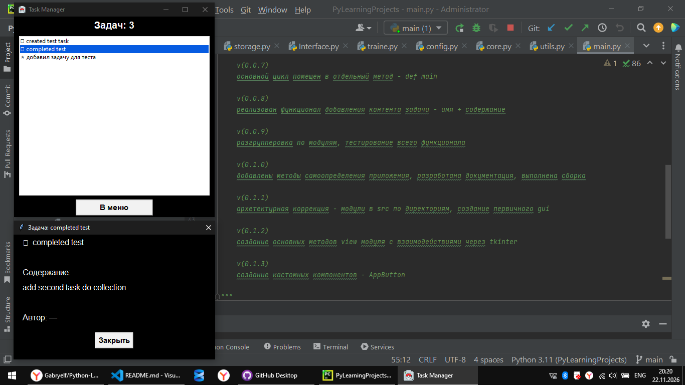
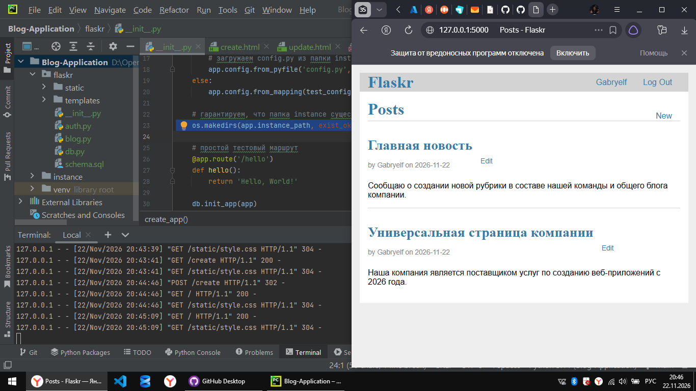
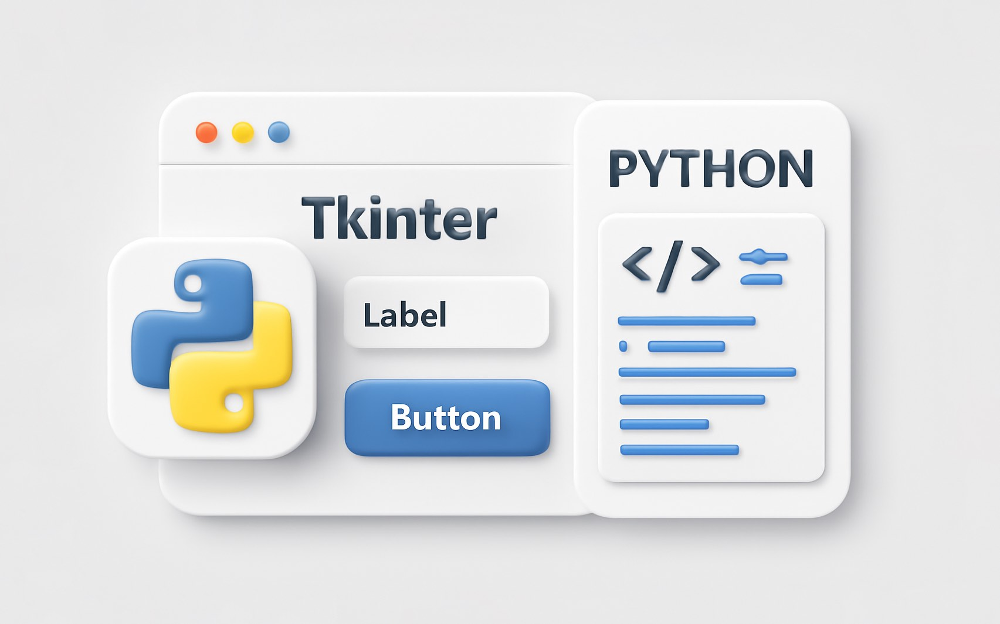

# Python-Lerning-Cours

# 1 Приложение для контроля задач TASK MANAGER

# 2 Приложение блог из документации по фреймворку Flask

## Документация по проекту и версиям
[Просмотр документации](https://github.com/Gabryelf/Python-Lerning-Course/blob/main/documents/BACKLOG.md)

## Установка приложения
[Инструкция по установке](https://github.com/Gabryelf/Python-Lerning-Course/blob/main/documents/INSTALLING.md)

